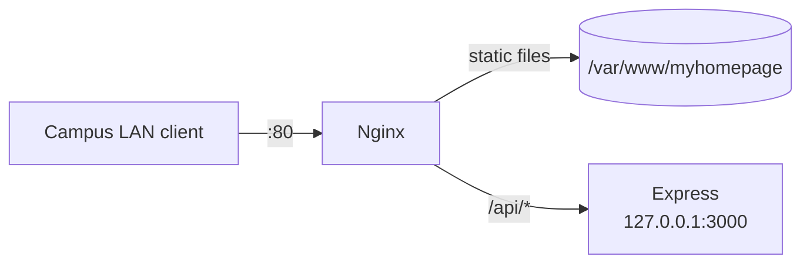

<div align="center">

# Orange Pi deployment · USTC MyHomePage

Nginx configuration, an optional Node.js API, install scripts and operations
notes for running [USTC MyHomePage](https://github.com/2024-ustc-yuqing-cup-wd-team/myhomepage)
on an Orange Pi over the campus LAN.

[](https://github.com/2024-ustc-yuqing-cup-wd-team/orangepi-server/actions/workflows/ci.yml)
[](LICENSE)
[](#status)

</div>

## Overview

The front end in
[`myhomepage`](https://github.com/2024-ustc-yuqing-cup-wd-team/myhomepage) is a static
site, so it can be served by GitHub Pages. This repository holds the other half:
the setup that ran it on an **Orange Pi** during the 2024 Yuqing Cup.

- **Nginx** serves the site from `/var/www/myhomepage` and proxies `/api/` to the
  loopback API.
- **Express** provides `GET /api/health` and a place for future endpoints. It is
  optional — remove the `/api/` block if you only need the static site.
- **Scripts** install everything in one go and update the site later.
- **Docs** cover setup, operations, the architecture and the IMAP example.

## Topology



The API binds to `127.0.0.1` only; Nginx is the single entry point. All user data
(bookmarks, events) lives in the visitor's browser, so the server stores no
personal data.

## Quick start

Requirements: Debian/Ubuntu on ARM64, Node.js 20+, git, Nginx.

```bash
git clone https://github.com/2024-ustc-yuqing-cup-wd-team/orangepi-server.git
cd orangepi-server
sudo bash deploy/scripts/bootstrap.sh
```

The script installs Nginx, clones the site into `/var/www/myhomepage`, installs
the API into `/opt/myhomepage-api`, enables both services and verifies them with
`curl`.

```bash
curl http://127.0.0.1/api/health
# {"status":"ok","service":"myhomepage-api","version":"1.0.0","uptimeSeconds":1}
```

From another machine on the same network, open `http://<board-ip>/`.

Step-by-step instructions, including the ARM64 Node.js install and a manual
installation path, are in [docs/setup.md](docs/setup.md).

## Local development

The API:

```bash
cd server
cp .env.example .env
npm ci
npm start
# http://127.0.0.1:3000/api/health
```

The static site:

```bash
git clone https://github.com/2024-ustc-yuqing-cup-wd-team/myhomepage.git
cd myhomepage
python3 -m http.server 8000
```

Nginx is not required for development; browse the static site directly.

## Configuration

`/opt/myhomepage-api/.env`:

| Variable | Default | Meaning |
| --- | --- | --- |
| `NODE_ENV` | `production` | Node environment |
| `HOST` | `127.0.0.1` | Bind address (keep on loopback) |
| `PORT` | `3000` | Port proxied by Nginx |

The site path is configured in
[`deploy/nginx/sites-available/myhomepage.conf`](deploy/nginx/sites-available/myhomepage.conf)
(`root /var/www/myhomepage;`) and can be overridden when bootstrapping with
`SITE_DIR=...`.

## Repository layout

```text
orangepi-server/
├── deploy/
│   ├── nginx/
│   │   ├── nginx.conf                      # optional tuned main config
│   │   └── sites-available/myhomepage.conf # static site + /api proxy
│   ├── scripts/
│   │   ├── bootstrap.sh                    # first-time installation
│   │   └── deploy-site.sh                  # update the static site
│   └── systemd/myhomepage-api.service
├── server/                                 # optional Express API
├── examples/imap-reader/                   # read-only IMAP example
├── docs/
│   ├── setup.md
│   ├── operations.md
│   ├── architecture.md
│   └── imap.md
└── .github/                                # issue templates and CI
```

## Documentation

| Document | What it covers |
| --- | --- |
| [Setup](docs/setup.md) | From a fresh board to a working deployment |
| [Operations](docs/operations.md) | Services, logs, updates, backups, troubleshooting |
| [Architecture](docs/architecture.md) | Request flow, ports, storage model |
| [IMAP notes](docs/imap.md) | Environment-based mail access |

## What changed in the 2026 cleanup

The repository used to be a personal notebook: a `note.md` with the Nginx config
pasted in, a committed `node_modules/` (590 files), GBK-encoded scripts and a
hard-coded mail credential. The cleanup:

- moved the configuration out of prose into real files under `deploy/`;
- fixed the routing bug: `location /` proxied **every** request to Node, so the
  static site was never served — now only `/api/` is proxied;
- removed the committed `node_modules/` and the hard-coded credential, and
  rewrote the history accordingly;
- replaced the ad-hoc IMAP script with a read-only, environment-driven example;
- converted the sources to UTF-8 and added a systemd unit with basic hardening;
- added CI, issue templates and documentation.

## Status

This is the **server-side archive of a 2024 competition entry**. It is not under
active development; fixes and documentation improvements are welcome.

## License

[MIT](LICENSE) © 2024 WD Team (USTC Team 25, 2024 Yuqing Cup)
