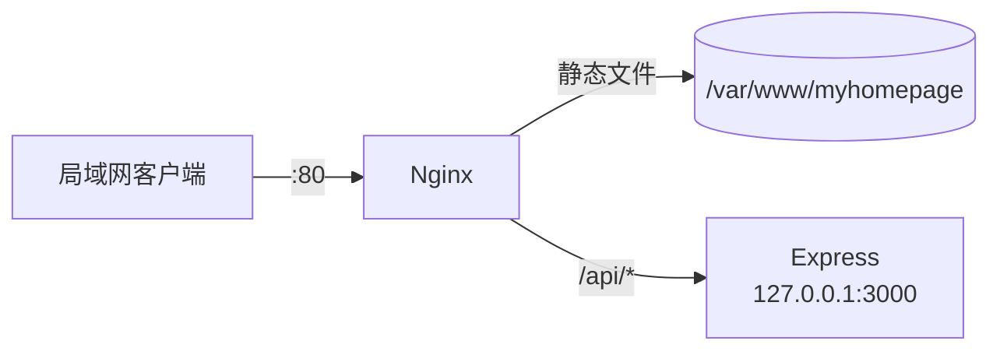

<div align="center">

# Orange Pi 部署 · USTC MyHomePage

给 [USTC MyHomePage](https://github.com/2024-ustc-yuqing-cup-wd-team/myhomepage)
用的服务端配置：Nginx、可选的 Node.js API、安装脚本和运维说明，
2024 年余庆杯期间跑在 Orange Pi 的校园局域网里。

[](https://github.com/2024-ustc-yuqing-cup-wd-team/orangepi-server/actions/workflows/ci.yml)
[](LICENSE)

</div>

## 这是什么

前端 [`myhomepage`](https://github.com/2024-ustc-yuqing-cup-wd-team/myhomepage)
是纯静态站点，可以直接放 GitHub Pages。这个仓库是它的另一半：
2024 年比赛时把它跑在 Orange Pi 上的那套配置。

- **Nginx**：从 `/var/www/myhomepage` 提供静态文件，把 `/api/` 反代到本机 API。
- **Express**：提供 `GET /api/health`，同时给以后可能的后端接口留位置。
  不需要后端的话，删掉 `/api/` 那个 location 即可。
- **脚本**：一键安装，之后单独更新站点。
- **文档**：安装、运维、架构、IMAP 示例。

## 拓扑



API 只监听 `127.0.0.1`，对外只有 Nginx 一个入口。书签和日程都存在访问者的浏览器里，
服务器不保存个人数据。

## 快速开始

要求：ARM64 的 Debian/Ubuntu、Node.js 20+、git、Nginx。

```bash
git clone https://github.com/2024-ustc-yuqing-cup-wd-team/orangepi-server.git
cd orangepi-server
sudo bash deploy/scripts/bootstrap.sh
```

脚本会安装 Nginx、把站点 clone 到 `/var/www/myhomepage`、把 API 安装到
`/opt/myhomepage-api`、启用两个服务并用 `curl` 自检。

```bash
curl http://127.0.0.1/api/health
```

在局域网另一台机器上打开 `http://<板子 IP>/` 即可。

包含 ARM64 Node.js 安装和手动安装步骤的详细说明见
[docs/setup.md](docs/setup.md)。

## 本地开发

API：

```bash
cd server
cp .env.example .env
npm ci
npm start
# http://127.0.0.1:3000/api/health
```

静态站点：

```bash
git clone https://github.com/2024-ustc-yuqing-cup-wd-team/myhomepage.git
cd myhomepage
python3 -m http.server 8000
```

本地开发不需要 Nginx。

## 配置

`/opt/myhomepage-api/.env`：

| 变量 | 默认值 | 说明 |
| --- | --- | --- |
| `NODE_ENV` | `production` | Node 环境 |
| `HOST` | `127.0.0.1` | 监听地址，保持 loopback |
| `PORT` | `3000` | Nginx 反代的端口 |

站点目录在
[`deploy/nginx/sites-available/myhomepage.conf`](deploy/nginx/sites-available/myhomepage.conf)
里配置（`root /var/www/myhomepage;`），安装时可以用 `SITE_DIR=...` 覆盖。

## 目录结构

```text
orangepi-server/
├── deploy/
│   ├── nginx/                 # 主配置（可选）+ myhomepage server block
│   ├── scripts/               # bootstrap.sh / deploy-site.sh
│   └── systemd/               # myhomepage-api.service
├── server/                    # 可选的 Express API
├── examples/imap-reader/      # 只读 IMAP 示例
├── docs/                      # setup / operations / architecture / imap
└── .github/                   # issue 模板、CI
```

## 文档

| 文档 | 内容 |
| --- | --- |
| [安装](docs/setup.md) | 从空板子到可访问的站点 |
| [运维](docs/operations.md) | 服务、日志、更新、备份、排错 |
| [架构](docs/architecture.md) | 请求流、端口、数据存储 |
| [IMAP](docs/imap.md) | 用环境变量访问邮箱 |

## 2026 年清理了什么

这个仓库原来更像个人笔记：`note.md` 里贴着一整段 Nginx 配置，`node_modules/`
（590 个文件）被提交，脚本是 GBK 编码，还有一个写死的邮箱凭据。这次清理：

- 把配置从文字里抽成 `deploy/` 下的真实文件；
- 修了路由 bug：原来 `location /` 把所有请求都反代给 Node，静态站点根本访问不到，
  现在只反代 `/api/`；
- 删掉提交进仓库的 `node_modules/` 和写死的凭据，并重写了历史；
- 把临时 IMAP 脚本换成只读、从环境变量读配置的示例；
- 源码统一为 UTF-8，systemd 单元加了基础加固；
- 补上 CI、issue 模板和文档。

## 状态

这是 **2024 年比赛作品的服务端存档**，不再继续开发；欢迎修 bug 和改文档。

## 许可证

[MIT](LICENSE) © 2024 WD Team（2024 余庆杯第 25 队）
