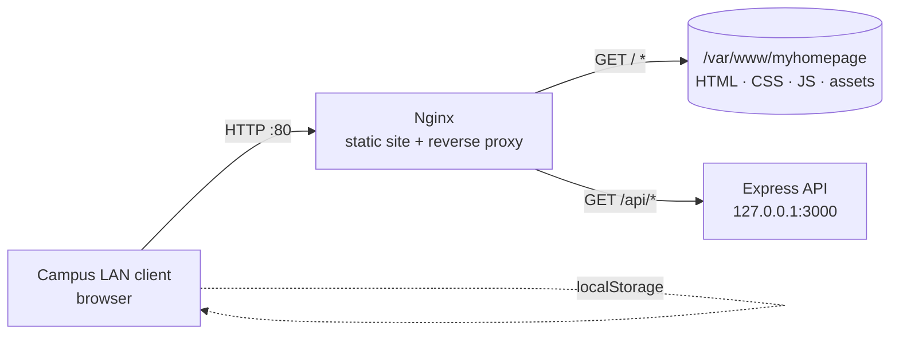

# Architecture

## Topology



The deployment is intentionally small: one Nginx instance serves the static site
and proxies a single optional API. The browser keeps all user state locally, so
the server stores no personal data.

## Request flow

| Request | Handled by | Notes |
| --- | --- | --- |
| `GET /` | Nginx | Serves `index.html` from `/var/www/myhomepage` |
| `GET /bookmarks` | Nginx | `try_files` falls back to `bookmarks.html` |
| `GET /assets/*` | Nginx | Cached for seven days |
| `GET /api/health` | Express | JSON health check through the proxy |
| `GET /api/*` (unknown) | Express | `404 {"error":"not_found"}` |

## Ports and services

| Port | Process | Exposure |
| --- | --- | --- |
| 80 | Nginx | Campus LAN |
| 3000 | Node.js (`myhomepage-api`) | Loopback only (`127.0.0.1`) |
| 22 | SSH | Administrative access |

The API binds to loopback by default (`HOST=127.0.0.1`) so it cannot be reached
directly from the network; Nginx is the only public entry point.

## Data storage

| Data | Where | Lifetime |
| --- | --- | --- |
| Bookmarks | Browser `localStorage` (`mh.bookmarks.v1`) | Until the user clears site data |
| Events | Browser `localStorage` (`mh.calendar.events.v1`) | Until the user clears site data |
| Site files | `/var/www/myhomepage` | Deployed from the `myhomepage` repository |
| API config | `/opt/myhomepage-api/.env` | Server-local, not committed |

There is no database and no user account. Clearing the browser's site data
removes the user's bookmarks and events; the server never had a copy.

## Why static-first

- The two features are client-side by nature; a back end adds operational cost
  without adding value.
- The original use case was a LAN server without internet access, so the site is
  fully self-contained: no CDN, no font service, no favicon service.
- The same files deploy to GitHub Pages, which keeps a public demo alive without
  maintaining a second code path.

The Express service exists so that future server-side features have a home and
so the deployment has a machine-checkable health endpoint.

## Repository layout

```text
orangepi-server/
├── deploy/
│   ├── nginx/
│   │   ├── nginx.conf                      # optional tuned main config
│   │   └── sites-available/myhomepage.conf # server block (static + /api)
│   ├── scripts/
│   │   ├── bootstrap.sh                    # first-time installation
│   │   └── deploy-site.sh                  # update the static site
│   └── systemd/myhomepage-api.service
├── server/                                 # optional Express API
│   ├── src/index.js
│   ├── package.json
│   └── .env.example
├── examples/imap-reader/                   # env-based IMAP example
└── docs/
    ├── setup.md
    ├── operations.md
    ├── imap.md
    └── architecture.md
```
